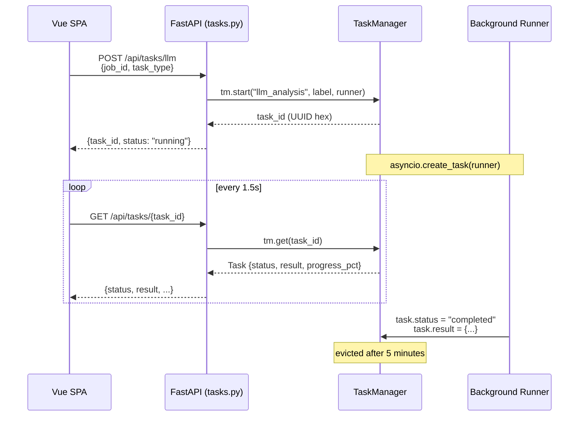

# Development Guide — Job Engine

This document contains the detailed technical reference for developers contributing to or extending the Job Engine. For user-facing documentation, see [README.md](README.md).

---

## Table of Contents

- [Development Guide — Job Engine](#development-guide--job-engine)
  - [Table of Contents](#table-of-contents)
  - [Prerequisites \& Installation](#prerequisites--installation)
  - [Key Commands](#key-commands)
  - [Vue 3 SPA Frontend](#vue-3-spa-frontend)
    - [Development](#development)
    - [Production SPA Serving](#production-spa-serving)
    - [JSON API Endpoints](#json-api-endpoints)
    - [HTML Route Endpoints](#html-route-endpoints)
  - [Scraper Framework](#scraper-framework)
    - [How Scraping Works](#how-scraping-works)
    - [How Scoring Works](#how-scoring-works)
    - [Self-Registering Registry](#self-registering-registry)
    - [Stealth \& Anti-Detection](#stealth--anti-detection)
    - [BrowserScraper Base Class](#browserscraper-base-class)
    - [Proxy Support](#proxy-support)
  - [Scraper Output Contract — JobOffer Fields](#scraper-output-contract--joboffer-fields)
    - [Required Fields](#required-fields)
    - [Scoring-Critical Fields](#scoring-critical-fields)
    - [Optional Enrichment Fields](#optional-enrichment-fields)
    - [Extended Fields](#extended-fields)
    - [Per-Scraper Field Coverage Matrix](#per-scraper-field-coverage-matrix)
    - [Scraper Tiers by Data Richness](#scraper-tiers-by-data-richness)
  - [Company Entity](#company-entity)
  - [Matching Engine Dimensions](#matching-engine-dimensions)
  - [Testing](#testing)
    - [Python Tests (pytest)](#python-tests-pytest)
    - [Node.js Scraper Tests (node:test)](#nodejs-scraper-tests-nodetest)
    - [Scraper Testing Discipline](#scraper-testing-discipline)
    - [Test Patterns](#test-patterns)
  - [LLM Module 🧠](#llm-module-)
  - [Dashboard-Controlled Scraping](#dashboard-controlled-scraping)
  - [Unified TaskManager](#unified-taskmanager)
    - [Architecture](#architecture)
    - [Backend API](#backend-api)
    - [Scraper Run tasks](#scraper-run-tasks)
    - [Frontend Composable: `useTaskPoll`](#frontend-composable-usetaskpoll)
    - [`useTaskPoll` Usage Example](#usetaskpoll-usage-example)
    - [Task Types](#task-types)
    - [Adding a New Task Type](#adding-a-new-task-type)
  - [Scraper Catalog](#scraper-catalog)
    - [Architecture](#architecture-1)
    - [Dashboard Catalog Tab](#dashboard-catalog-tab)
    - [CLI Commands](#cli-commands)
    - [Per-Scraper Configuration](#per-scraper-configuration)
  - [CSS \& Styling Conventions](#css--styling-conventions)
    - [Global CSS Files](#global-css-files)
    - [CSS Migration Status](#css-migration-status)
    - [Rules for Contributors](#rules-for-contributors)
  - [Story Bank — STAR Interview Preparation](#story-bank--star-interview-preparation)
    - [Recommended Story Bank Format](#recommended-story-bank-format)
    - [Using the Story Bank](#using-the-story-bank)
  - [Configuration](#configuration)
  - [Commit Guidelines](#commit-guidelines)

---

## Prerequisites & Installation

**Prerequisites:**
- Python 3.10+
- Node.js 18+
- npm 9+

```bash
# Copy environment template
cp config/.env.example config/.env

# Create your profile
cp examples/my_profile.example.yaml data/my_profile.yaml

# Install everything
make install
```

`make install` runs:
1. `pip install -e packages/job-engine-core` — Python core in editable mode
2. `pip install -e packages/job-engine-dashboard` — Dashboard backend in editable mode
3. `cd packages/job-engine-scrapers && npm install` — Scraper npm workspace
4. `cd packages/job-engine-dashboard && npm install` — Vue SPA dependencies
5. `make build` — Build the Vue 3 SPA

---

## Key Commands

| `make …` | What it does |
|----------|-------------|
| `install` | Install everything (see above) |
| `score` | `python -m job_engine.skill_scorer data/scraper-output/_all.json --top 10` |
| `seed` | `python scripts/seed.py` — re-seed DB from JSON (auto-called after a dashboard scraper run) |
| `dashboard` | `uvicorn dashboard.main:app --reload --port 8000` (via editable package) |
| `test` | `python -m pytest packages/job-engine-core/tests/ -v --tb=short` |
| `test-scrapers` | `cd packages/job-engine-scrapers && npm test` — Node.js scraper structural tests |
| `test-all` | Run both `test` and `test-scrapers` |
| `clean` | Remove `__pycache__/` and scraper output JSONs |
| `lint` | `ruff check packages/job-engine-core/ packages/job-engine-dashboard/` |
| `format` | `ruff format packages/job-engine-core/ packages/job-engine-dashboard/` |
| `typecheck` | `pyright packages/job-engine-core/src/ packages/job-engine-dashboard/src/` |
| `llm-test` | Verify LLM/OpenRouter connectivity |
| `docker-build` | `docker compose build` |
| `docker-up` | `docker compose up` |
| `build` | `cd packages/job-engine-dashboard && npm run build` — Build Vue 3 SPA |
| `dev` | `cd packages/job-engine-dashboard && npm run dev` — Vite dev server with HMR |
| `refresh-rates` | Refresh cached currency exchange rates |
| `rates-status` | Show cached rate source, count, and age |
| `scraper-install` | `ID=<name> make scraper-install` — Install a scraper from the catalog |
| `scraper-uninstall` | `ID=<name> make scraper-uninstall` — Uninstall a scraper |
| `scraper-metadata` | Dump registry metadata for Python `scraper_config.py` |
| `migrate` | Migrate an existing DB to the current schema (companies, tech_stack, etc.) |

---

## Vue 3 SPA Frontend

The dashboard has been **fully migrated** from Jinja2 templates + Vanilla JS to a **Vue 3 SPA** built with Vite. The SPA is the primary interface; the FastAPI backend serves only the JSON REST API.

| Layer | Technology |
|-------|-----------|
| Framework | Vue 3 (Composition API + `<script setup>`) |
| Router | vue-router 4 (client-side SPA routing) |
| State | Pinia (replacing `data-*` attrs + global vars) |
| Build | Vite 6 |
| Styling | `<style scoped>` + global CSS variables from `dashboard/static/css/core.css` |

### Development

```bash
# Terminal 1 — Vite dev server (hot reload)
cd packages/job-engine-dashboard && npm run dev

# Terminal 2 — FastAPI (API backend)
make dashboard
```

Vite proxies `/api/*` and `/static/*` to `http://localhost:8000` during development.

### Production SPA Serving

The built SPA (`packages/job-engine-dashboard/dist/`) is served by the FastAPI server:
- Built assets (`dist/assets/`) are mounted at `/assets/`
- A catch-all route (`/{full_path:path}`) serves `dist/index.html` for all frontend routes (API routes take precedence)
- Legacy `dashboard/static/` CSS/JS files remain for Vite dev proxy compatibility


### JSON API Endpoints

| Method | Endpoint | Purpose |
|--------|----------|---------|
| GET | `/api/jobs` | Scored, filtered, paginated job list |
| GET | `/api/jobs/{id}` | Single job detail with match breakdown |
| GET | `/api/jobs/fields` | Filter enums (platforms, skills, categories) |
| GET | `/api/companies` | Company list (JSON) |
| GET | `/api/scrape/scrapers` | Scraper list with enabled state |
| PUT | `/api/scrape/scrapers/{id}` | Toggle scraper enabled |
| POST | `/api/scrape` | Trigger a scraper run (returns `task_id`) |
| GET | `/api/scrape/status` | Active scraper run status |
| PATCH | `/api/profile` | Update profile |
| GET | `/api/jobs/{id}/analysis` | Cached LLM analysis (read-only) |
| POST | `/api/jobs/{id}/fetch-content` | Fetch offer URL content + trigger background LLM |
| **POST** | **`/api/tasks/llm`** | **Trigger background LLM analysis or application letter** |
| **GET** | **`/api/tasks`** | **List tasks (filter by type/status)** |
| **GET** | **`/api/tasks/{task_id}`** | **Poll a task for status/result/progress** |
| **DELETE** | **`/api/tasks/{task_id}`** | **Cancel a running task** |
| **GET** | **`/api/tasks/{task_id}/logs`** | **Get log lines for a task** |

### HTML Route Endpoints

| Route | Description |
|-------|-------------|
| `GET /` | Dashboard with charts |
| `GET /jobs` | Job listing with filters |
| `GET /jobs/{id}` | Job detail with LLM actions |
| `GET /jobs/{id}/cover-letter` | Cover letter page |
| `PATCH /jobs/{id}/toggle-hide` | Toggle job visibility |
| `POST /jobs/{id}/fetch-content` | Fetch full job content |
| `GET /companies` | Company list page (HTML) |
| `GET /companies/{id}` | Company detail with jobs (HTML) |
| `GET /scrapers` | Scraper management dashboard |

---

## Scraper Framework

> 📖 **Creating a new scraper?** See [`packages/job-engine-scrapers/CREATING_A_SCRAPER.md`](../packages/job-engine-scrapers/CREATING_A_SCRAPER.md)
> for a step-by-step tutorial, scaffolding tool reference, and the full JobOffer contract guide.
>
> Quick start: `cd packages/job-engine-scrapers && node create-scraper.mjs <id> --type <api|fetch|browser> --name "Display Name"`

### How Scraping Works

`packages/job-engine-scrapers/run.js` discovers installed scrapers via the self-registering registry (`packages/job-engine-scrapers/core/registry.js`), then runs the ones enabled in `data/scraper_config.yaml`. Search keywords are not hard-coded: they are collected from the `skills` tree and `boosted_keywords` in `data/my_profile.yaml` (platforms with server-side search use only `boosted_keywords` to keep queries focused). If `preferences.remote_only: true` is set, non-remote listings are filtered out. Results land in `data/scraper-output/`, then `scripts/seed.py` loads them into a SQLite database.

### How Scoring Works

`JobMatcher` scores each job across 8 weighted dimensions:

| Dimension | Weight | What it measures |
| --- | --- | --- |
| Skill overlap | 25% | How many of your skills appear in the listing |
| Keyword boost | 15% | Hits on your high-signal domain keywords |
| Career alignment | 15% | Fit with long-term trajectory and domain interests |
| Behavioral fit | 13% | Culture, collaboration, and growth signals |
| Rate fit | 12% | Salary range vs your expected rate (multi-currency) |
| Location fit | 8% | Remote / city / hybrid vs your preferences |
| Category fit | 8% | Job category vs your skill categories |
| Experience fit | 4% | Seniority level match |

Skills in your `critical_categories` add a bonus on top (+5 per match, capped at +20). The full breakdown is shown per job in the dashboard.

### Self-Registering Registry

Each scraper package calls `registry.register(scraperModule)` on import. The `ScraperRegistry` singleton collects all registered modules. At runtime, `run.js` calls `registry.getActive(scraperConfig)` to get only the enabled scrapers. The registry also handles metadata (data richness, category, type) for the dashboard's catalog UI.

### Stealth & Anti-Detection

`core/stealth.js` provides:
- **Fingerprint randomization** — varies viewport, user agent, and browser features per session
- **Human-mimic delays** — random pauses between actions, varied scroll behaviour
- **Retry logic** — exponential backoff on failure with configurable max retries
- **Cookie/session management** — isolates sessions between runs

### BrowserScraper Base Class

`core/browserScraper.js` is a shared Playwright base class that scrapers can extend. It provides:
- Automatic browser launch/context management with stealth
- Stealth fingerprint randomization per-navigation
- Page navigation with WAF detection (Cloudflare, reCAPTCHA, etc.)
- Screenshot capture on failure for debugging
- Resource blocking (images, fonts, media) for faster scraping + reduced fingerprint
- Human-mimic behavior (delays, scrolling, mouse movements)
- Proxy support with automatic fallback
- Configurable `SCRAPER_STEALTH_LEVEL` (minimal / balanced / paranoid)

**Usage:**
```js
const BrowserScraper = require("@job-engine-scrapers/core").browserScraper;

class MyScraper extends BrowserScraper {
  get id() { return "myscraper"; }
  get platform() { return "myscraper.com"; }
  buildUrl(tag, pageNum) { return `https://myscraper.com/jobs?q=${tag}`; }
  async extractJobs(page, tag, pageNum) { /* ... */ }
}

const scraper = new MyScraper({ maxPages: 3, headless: true, blockResources: true });
const result = await scraper.scrape();
```

### Proxy Support

`core/proxy.js` reads `HTTP_PROXY` and `HTTPS_PROXY` environment variables and configures Playwright to route traffic through the proxy. Also provides:

- **Dynamic proxy rotation** — fetches proxy lists from configured `PROXY_SOURCES` URLs, caches them with TTL, returns a random proxy per call
- **Proxy health checks** — `checkProxyHealth(url)` tests a proxy against `PROXY_HEALTH_CHECK_URL` before use
- **WebRTC leak prevention** — `getBrowserLaunchArgs(proxyUrl)` returns Chromium args that hide local IPs via mDNS when a proxy is active
- Supports authenticated proxies via `PROXY_USERNAME` and `PROXY_PASSWORD` env vars

---

## Scraper Output Contract — JobOffer Fields

Every scraper produces JSON objects conforming to the `JobOffer` typedef (defined in `packages/job-engine-scrapers/core/scraper-interface.js`). The fields map to the `Job` SQLAlchemy model columns in `packages/job-engine-core/src/job_engine/models.py`.

### Required Fields

Must be non-empty, or the job is dropped by `writeOutput()`.

| Field | DB Column | Type | Description |
|-------|-----------|------|-------------|
| `external_id` | `external_id` | `string` | Platform-unique ID, e.g. `justjoin_<guid>`, `indeed_<hash>`. Constructed by `stableId()` in `core/dedup.js` or platform logic. |
| `platform` | `platform` | `string` | Source platform name, e.g. `justjoin.it`, `nofluffjobs`, `linkedin`. Hard-coded per scraper. |
| `title` | `title` | `string` | Job title from the listing. |
| `company` | → `company_id` (FK) | `string` | Company name. Auto-resolved to `Company` entity on DB import. |
| `url` | `url` | `string` | Direct link to the job posting. |

### Scoring-Critical Fields

Strongly recommended; missing values degrade match scores.

| Field | DB Column | Type | Description |
|-------|-----------|------|-------------|
| `salary_min` | `salary_min` | `number \| null` | Minimum / from salary. Parsed via shared `core/salary.js` utilities (supports `$100k`, `PLN`, `€`, ranges). |
| `salary_max` | `salary_max` | `number \| null` | Maximum / to salary. |
| `currency` | `currency` | `string` | ISO-ish code (`USD`, `EUR`, `GBP`, `PLN`). Default varies by platform. |
| `skills` | `skills` | `string[]` | Skill keyword list. Extracted from API data, DOM, or via shared `extractSkills()` regex. Stored as JSON. |
| `remote` | `remote` | `boolean` | Whether the role is fully remote. |
| `location` | `location` | `string` | Human-readable location (city, region, or `Remote`). |
| `category` | `category` | `string` | Job category key (e.g. `python`, `blockchain`, `data`). Used for `category_fit` scoring. |
| `experience_level` | `experience_level` | `string` | Seniority label (e.g. `junior`, `mid`, `senior`, `trainee`). Used for `experience_fit` scoring. |
| `contract_type` | `contract_type` | `string` | Employment type: `B2B`, `PERMANENT`, `UoP`, `UZ`, `UD`, `full_time`, `part_time`, `contract`, `freelance`, `internship`, or `other`. |

### Optional Enrichment Fields

Set by rich scrapers; improve analysis.

| Field | DB Column | Type | Description |
|-------|-----------|------|-------------|
| `requirements` | `description` | `string` | Full job requirements / description text. Used as fallback when no separate `description` exists. On DB import, mapped to `description` column. |
| `description` | `description` | `string` | Full job description (preferred over `requirements`). |
| `nice_to_have_skills` | `nice_to_have_skills` | `string` (JSON) | JSON array of nice-to-have skill strings. |
| `languages` | `languages` | `string` (JSON) | JSON array of `{code, level}` or `{name, level}` objects. |
| `published_at` | `published_at` | `string \| null` | ISO timestamp of original publication. |
| `expired_at` | `expired_at` | `string \| null` | ISO timestamp of expiry. |
| `last_published_at` | `last_published_at` | `string \| null` | ISO timestamp of last re-publication. |
| `working_time` | `working_time` | `string` | `full_time`, `part_time`, or `flexible`. |
| `latitude` | `latitude` | `number \| null` | Geographic latitude. |
| `longitude` | `longitude` | `number \| null` | Geographic longitude. |
| `street` | `street` | `string` | Street address. |

### Extended Fields

Beyond the JobOffer typedef; set by specific scrapers.

| Field | DB Column | Type | Set By | Description |
|-------|-----------|------|--------|-------------|
| `benefits` | `benefits` | `string` (JSON) | nofluffjobs, solidjobs | JSON array of benefit strings. |
| `hybrid` | `hybrid` | `boolean` | pracuj, solidjobs | Whether the role is hybrid. |
| `city` | `city` | `string` | solidjobs | City from location data. |
| `division` | `division` | `string` | solidjobs | Division/category detail from API. |
| `salary_period` | — | `string` | pracuj | `hour`, `month`, or `year` from salary text. |
| `secondary_salary_min` | `secondary_salary_min` | `number \| null` | solidjobs | Salary for alternative contract type (e.g. UoP when primary is B2B). |
| `secondary_salary_max` | `secondary_salary_max` | `number \| null` | solidjobs | Max for alternative contract. |
| `secondary_currency` | `secondary_currency` | `string` | solidjobs | Currency for alternative contract. |
| `secondary_contract_type` | `secondary_contract_type` | `string` | solidjobs | Label for alternative contract (e.g. `UoP`). |
| `valid_from` | `valid_from` | `string` | solidjobs | ISO datetime when the posting becomes valid. |
| `valid_to` | `valid_to` | `string` | solidjobs | ISO datetime when the posting expires. |
| `company_url` | → `Company.url` | `string` | nofluffjobs | Company website URL. |
| `company_logo_url` | → `Company.logo_url` | `string` | solidjobs | Company logo URL. |

### Per-Scraper Field Coverage Matrix

| Field | bul | cry1 | cry2 | goo | ind | joo | jji | lin | nfj | olx | pra | red | rok | shi | sol | upw |
|-------|:---:|:----:|:----:|:---:|:---:|:---:|:---:|:---:|:---:|:---:|:---:|:---:|:---:|:---:|:---:|:---:|
| `external_id` | ✅ | ✅ | ✅ | ✅ | ✅ | ✅ | ✅ | ✅ | ✅ | ✅ | ✅ | ✅ | ✅ | ✅ | ✅ | ✅ |
| `platform` | ✅ | ✅ | ✅ | ✅ | ✅ | ✅ | ✅ | ✅ | ✅ | ✅ | ✅ | ✅ | ✅ | ✅ | ✅ | ✅ |
| `title` | ✅ | ✅ | ✅ | ✅ | ✅ | ✅ | ✅ | ✅ | ✅ | ✅ | ✅ | ✅ | ✅ | ✅ | ✅ | ✅ |
| `company` | ⚠️ | ✅ | ✅ | ✅ | ✅ | ⚠️ | ✅ | ✅ | ✅ | ⚠️ | ✅ | 🏷️ | ✅ | ✅ | ✅ | ⚠️ |
| `url` | ✅ | ✅ | ✅ | ✅ | ✅ | ✅ | ✅ | ✅ | ✅ | ✅ | ✅ | ✅ | ✅ | ✅ | ✅ | ✅ |
| `salary_min` | ➖ | ✅ | ✅ | ✅ | ✅ | ➖ | ✅ | ✅ | ✅ | ➖ | ✅ | ➖ | ✅ | ✅ | ✅ | ✅ |
| `salary_max` | ➖ | ✅ | ✅ | ✅ | ✅ | ➖ | ✅ | ✅ | ✅ | ➖ | ✅ | ➖ | ✅ | ✅ | ✅ | ✅ |
| `currency` | ✅ | ✅ | ✅ | ✅ | ✅ | ✅ | ✅ | ✅ | ✅ | ✅ | ✅ | ✅ | ✅ | ✅ | ✅ | ✅ |
| `contract_type` | ✅ | ✅ | ✅ | ✅ | ✅ | ✅ | ✅ | ✅ | ✅ | ✅ | ✅ | ✅ | ✅ | ✅ | ✅ | ✅ |
| `location` | ➖ | ✅ | ✅ | ✅ | ✅ | ➖ | ✅ | ✅ | ✅ | ➖ | ✅ | ✅ | ✅ | ✅ | ✅ | ✅ |
| `remote` | ✅ | ✅ | ✅ | ✅ | ✅ | ✅ | ✅ | ✅ | ✅ | ✅ | ✅ | ✅ | ✅ | ✅ | ✅ | ✅ |
| `skills` | ➖ | ✅ | ✅ | ✅ | ✅ | ➖ | ✅ | ✅ | ✅ | ➖ | ✅ | ✅ | ✅ | ✅ | ✅ | ✅ |
| `category` | ➖ | ✅ | ✅ | ➖ | ➖ | ➖ | ✅ | ➖ | ✅ | ➖ | ➖ | ✅ | ➖ | ➖ | ✅ | ➖ |
| `experience_level` | ➖ | ➖ | ➖ | ➖ | ➖ | ➖ | ✅ | ➖ | ✅ | ➖ | ✅ | ➖ | ➖ | ➖ | ✅ | ➖ |
| `requirements` | ➖ | ✅ | ✅ | ✅ | ✅ | ➖ | ✅ | ✅ | ✅ | ➖ | ✅ | ✅ | ✅ | ✅ | ✅ | ➖ |
| `discovered_at` | ✅ | ✅ | ✅ | ✅ | ✅ | ✅ | ✅ | ✅ | ✅ | ✅ | ✅ | ✅ | ✅ | ✅ | ✅ | ✅ |
| `nice_to_have_skills` | ➖ | ✅ | ✅ | ✅ | ✅ | ➖ | ✅ | ✅ | ✅ | ➖ | ➖ | ✅ | ✅ | ✅ | ✅ | ✅ |
| `languages` | ➖ | ✅ | ✅ | ✅ | ✅ | ➖ | ✅ | ✅ | ✅ | ➖ | ➖ | ✅ | ✅ | ✅ | ✅ | ✅ |
| `published_at` | ➖ | ➖ | ✅ | ➖ | ✅ | ➖ | ✅ | ➖ | ✅ | ➖ | ➖ | ➖ | ✅ | ➖ | ✅ | ➖ |
| `expired_at` | ➖ | ➖ | ➖ | ➖ | ➖ | ➖ | ✅ | ➖ | ➖ | ➖ | ➖ | ➖ | ➖ | ➖ | ✅ | ➖ |
| `last_published_at` | ➖ | ➖ | ➖ | ➖ | ➖ | ➖ | ✅ | ➖ | ➖ | ➖ | ➖ | ➖ | ➖ | ➖ | ➖ | ➖ |
| `working_time` | ➖ | ✅ | ✅ | ✅ | ✅ | ➖ | ✅ | ✅ | ✅ | ➖ | ➖ | ✅ | ✅ | ✅ | ✅ | ✅ |
| `latitude` / `longitude` | ➖ | ➖ | ➖ | ➖ | ➖ | ➖ | ✅ | ➖ | ➖ | ➖ | ➖ | ➖ | ➖ | ➖ | ➖ | ➖ |
| `street` | ➖ | ➖ | ➖ | ➖ | ➖ | ➖ | ✅ | ➖ | ➖ | ➖ | ➖ | ➖ | ➖ | ➖ | ➖ | ➖ |

**Legend:**
- `✅` — always populated (may be null/empty string)
- `⚠️` — set to a static/placeholder value (e.g. `"BulldogJob"`, `"OLX"`, `"Upwork Client"`)
- `🏷️` — set to a semantic label (e.g. subreddit name `"forhire"` as company)
- `➖` — not populated (field absent or always empty)

**Platform key:** bul=BulldogJob, cry1=CryptocurrencyJobs, cry2=CryptoJobsList, goo=Google Jobs, ind=Indeed, joo=Jooble, jji=JustJoin.it, lin=LinkedIn, nfj=NoFluffJobs, olx=OLX, pra=Pracuj.pl, red=Reddit, rok=RemoteOK, shi=SimplyHired, sol=Solid.jobs, upw=Upwork

### Scraper Tiers by Data Richness

1. **Thin (6 fields + boilerplate):** bulldogjob, jooble, olx — scrape simple HTML listings with no salary, skills, or location data. `company` is a static placeholder.

2. **Browser with `extractSkills()` (rich listing, thin enrichment):** indeed, googlejobs, linkedin, simplyhired, reddit, upwork — use Playwright + `extractSkills()` regex on page text. Set enrichment fields to defaults (`nice_to_have_skills: "[]"`, `languages: "[]"`, etc.).

3. **API with real enrichment (richest data):** justjoin_it, nofluffjobs, solidjobs, cryptojobslist, remoteok — consume structured API responses and populate most optional fields with real data. justjoin_it is the most complete (every interface field). nofluffjobs and solidjobs add extended fields beyond the JobOffer interface.

---

## Company Entity

The system normalizes company names into a dedicated `Company` table with a FK from `Job`:

| Field | Type | Description |
|-------|------|-------------|
| `id` | PK | Auto-increment |
| `name` | String(255), unique | Normalized company name |
| `url` | Text (nullable) | Company website |
| `logo_url` | Text (nullable) | Company logo image |
| `description` | Text (nullable) | About the company |
| `industry` | String(100) (nullable) | Industry sector |
| `size_range` | String(50) (nullable) | Employee count e.g. "50-200" |
| `headquarters` | String(255) (nullable) | HQ location |
| `founded_year` | Integer (nullable) | Year founded |
| `linkedin_url` | Text (nullable) | LinkedIn company page |

Companies are auto-created on job import via `_get_or_create_company()` in `save_jobs_sync()`. For existing databases, run `make migrate` to create the companies table and back-fill `company_id`.

---

## Matching Engine Dimensions

| Component | Weight | Description |
|-----------|--------|-------------|
| `skill_overlap` | 25% | Profile skills vs job tech stack + critical skill bonus |
| `keyword_boost` | 15% | Boosted domain keywords (trading, fintech, ML) |
| `career_alignment` | 15% | Fit with long-term trajectory and domain interests |
| `behavioral_fit` | 13% | Culture, collaboration, and growth signals |
| `rate_fit` | 12% | Salary range vs expected rate (configurable currency) |
| `location_fit` | 8% | Remote / hybrid / city match |
| `category_fit` | 8% | Category (python, backend, data, ai) |
| `experience_fit` | 4% | Seniority level match |

Skills in your `critical_categories` add a bonus on top (+5 per skill match, capped at +20). The full breakdown is shown per job in the dashboard. This table is the canonical reference — see [How Scoring Works](#how-scoring-works) for the same dimensions with prose descriptions.

---

## Testing

### Python Tests (pytest)

```bash
make test               # all Python tests (runs from packages/job-engine-core/tests/)
python -m pytest packages/job-engine-core/tests/test_skill_scorer.py -v -k "test_name"  # single test
```

### Node.js Scraper Tests (node:test)

```bash
make test-scrapers      # all scraper tests (runs from packages/job-engine-scrapers)
cd packages/job-engine-scrapers && npm test -- --test-name-pattern "justjoin_it"  # single scraper
cd packages/job-engine-scrapers && node --test tests/test-core-skills.js  # single test file
```

### Scraper Testing Discipline

When modifying any scraper or scraper core module, **always run the scraper tests**:

1. **Structural tests** (`tests/test-scrapers-module.js`) — validates all 16 scrapers export correct metadata, `main()`, `register()`, and pass `validateScraperModule()`. Run this whenever you add a new scraper or change the registry/interface.
2. **Per-scraper tests** (`tests/scrapers/test-*.js`) — module structure + `main()` return shape. Run the relevant test when modifying a specific scraper.
3. **Core utility tests** (`tests/test-core-*.js`) — unit tests for `skills.js`, `tags.js`, `dedup.js`, `output.js`, `fetch.js`. Run these when touching shared utilities.
4. **Interface tests** (`tests/test-scraper-interface.js`) — validates `validateScraperModule()` and `validateJobOffer()` against sample jobs. Run when changing the interface contract.

**Test fixtures live in** `packages/job-engine-scrapers/tests/helpers/fixtures.js` — provides `SAMPLE_JOB_FULL`, `SAMPLE_JOB_MINIMAL`, `SAMPLE_JOB_MISSING_REQUIRED`, `mockRequire()`, `createTempFile()`, and `captureOutput()`.

### Test Patterns

- Tests use Node.js built-in `node:test` (no Jest/Mocha) — `describe`, `it`, `beforeEach`, `afterEach`
- Per-scraper tests verify module structure (metadata, main, register) and graceful error handling for network-dependent `main()` calls
- Core utility tests use pure unit tests with inline fixtures
- `mockRequire(path, mockExports)` patches `require.cache` for config mocking

---

## LLM Module 🧠

The `job_engine.llm` module wraps LangChain + OpenRouter for job intelligence:

| Function | Description |
|----------|-------------|
| `get_llm()` | Cached ChatOpenAI pointing at OpenRouter |
| `analyze_all_job()` | Combined semantic analysis + explain + cover letter + questions |
| `generate_application_letter()` | Personalized application letter with configurable style/tone/length |
| `summarize_job()` | One-paragraph job summary |

Set an LLM API key in the dashboard Settings tab to enable.

> **All LLM operations run as background tasks** via the unified `TaskManager` (see below). The frontend triggers them with `POST /api/tasks/llm` and polls `GET /api/tasks/{task_id}` for completion. Cached results are read from `GET /api/jobs/{id}/analysis`.

---

## Dashboard-Controlled Scraping

The dashboard at `/scrapers` provides a full scraper management interface:

- **Enable/disable** individual scrapers — toggles are persisted to `data/scraper_config.yaml`
- **Scheduled auto-runs** — configurable interval (`SCRAPER_AUTO_RUN_INTERVAL_MINUTES`, default 6h)
- **Manual trigger** — starts `node scrapers/run.js` via `ScraperRunManager` (tasks tracked by the unified `TaskManager`)
- **Live status** — real-time progress with job counts and duration (poll `GET /api/tasks/{task_id}`)
- **Run history** — review past run results and job counts per scraper

Scraper runs and LLM operations share the same background task infrastructure. For details see the [Unified TaskManager](#unified-taskmanager) section below.

---

## Unified TaskManager

All long-running background work — scraper runs, LLM analysis, and application letter generation — runs through a single `TaskManager` singleton (`packages/job-engine-core/src/job_engine/task_manager.py`). This replaces the old pattern of blocking HTTP endpoints for LLM operations with a consistent fire-and-forget + poll model.

### Architecture



### Backend API

**Trigger a background task:**

```bash
# LLM analysis (combined: skills, match, cover letter, questions)
curl -X POST http://localhost:8000/api/tasks/llm \
  -H 'Content-Type: application/json' \
  -d '{"job_id": "<external_id>", "task_type": "llm_analysis"}'

# Application letter
curl -X POST http://localhost:8000/api/tasks/llm \
  -H 'Content-Type: application/json' \
  -d '{"job_id": "<external_id>", "task_type": "llm_application_letter",
       "style": "professional", "tone": "neutral", "length": "medium"}'
```

Each returns `{"task_id": "abc123def456", "status": "running"}`.

**Poll a task:**

```bash
curl http://localhost:8000/api/tasks/abc123def456
```

Response when running:
```json
{
  "task_id": "abc123def456",
  "task_type": "llm_analysis",
  "label": "LLM Analysis: ext_123",
  "status": "running",
  "started_at": "2026-07-18T12:00:00+00:00",
  "completed_at": null,
  "elapsed_seconds": 3.2,
  "result": null,
  "error_message": null,
  "progress_pct": 30.0,
  "metadata": {"job_id": "ext_123"},
  "log_line_count": 5
}
```

Response when completed:
```json
{
  "task_id": "abc123def456",
  "status": "completed",
  "result": {
    "analysis": {"key_skills": ["Python", "Django"], "seniority": "Senior"},
    "explanation": {"summary": "Strong match...", "score": 85},
    "cover_letter": "Dear Hiring Manager...",
    "questions": ["Tell me about..."]
  },
  ...
}
```

**Other task endpoints:**

| Endpoint | Method | Purpose |
|----------|--------|---------|
| `/api/tasks` | GET | List tasks (`?task_type=scraper_run&status=running&limit=10`) |
| `/api/tasks/{id}` | DELETE | Cancel a running task |
| `/api/tasks/{id}/logs` | GET | Tail log lines (`?offset=0`) |

### Scraper Run tasks

Scraper runs also use the unified `TaskManager`. The legacy `/api/scrape` endpoints still work but now return `task_id` alongside `run_id`:

```bash
curl -X POST http://localhost:8000/api/scrape
# => {"task_id": "abc...", "status": "running", "started_at": "..."}
```

Poll with `GET /api/tasks/{task_id}` for unified status, or `GET /api/scrape/status/{task_id}` for scraper-specific fields (scraper_statuses, job counts, issues).

### Frontend Composable: `useTaskPoll`

The composable at `src/composables/useTaskPoll.js` abstracts the polling lifecycle:

```js
import { useTaskPoll } from '@/composables/useTaskPoll.js'
import { ref } from 'vue'

const taskId = ref('abc123def456')
const { status, result, error, isRunning, cancel } = useTaskPoll(taskId)

// `status` → 'running' | 'completed' | 'failed' | null
// `isRunning` → boolean (starts/stops polling automatically)
// `cancel()` → sends DELETE to /api/tasks/{id}
```

The composable:
- Polls `GET /api/tasks/{task_id}` every 1.5 seconds while the task is running
- Stops automatically on `completed` or `failed`
- Deeply reactive — all refs update on each poll tick
- Cleans up on component unmount
- Supports `cancel()` to abort a running task

### `useTaskPoll` Usage Example

```js
import { useTaskPoll } from '@/composables/useTaskPoll.js'

const taskId = ref(null)
const { status, result, loading } = useTaskPoll(taskId)

async function triggerLlmAnalysis(jobId) {
  const res = await fetch('/api/tasks/llm', {
    method: 'POST',
    headers: { 'Content-Type': 'application/json' },
    body: JSON.stringify({ job_id: jobId, task_type: 'llm_analysis' }),
  })
  const data = await res.json()
  taskId.value = data.task_id  // triggers polling
}

// Later, when result is ready:
watch(result, (val) => {
  if (val?.analysis) {
    console.log('Analysis complete:', val.analysis)
  }
})
```

### Task Types

| `task_type` | Runner | Description |
|-------------|--------|-------------|
| `scraper_run` | `_run_scraper_task` | Spawns Node.js `run.js` subprocess, monitors stdout events, seeds DB |
| `llm_analysis` | `_run_llm_analysis` | Runs `analyze_all_job()` in a thread, saves results to DB cache fields |
| `llm_application_letter` | `_run_llm_application_letter` | Runs `generate_application_letter()` in a thread with configurable settings |

### Adding a New Task Type

1. Write an async runner function with signature `async def runner(task: Task, ...) -> None`
2. Call `tm.start("my_task_type", "human label", runner, metadata={...})`
3. The runner updates `task.status`, `task.result`, `task.progress_pct`, `task.add_log(...)` as it progresses

```python
from job_engine.task_manager import get_task_manager

async def my_runner(task: Task, payload: str) -> None:
    task.progress_pct = 10.0
    task.add_log(f"Processing {payload}...")
    # ... do work ...
    task.result = {"output": "done"}
    task.status = "completed"

# Trigger it:
tm = get_task_manager()
task_id = await tm.start("my_custom_type", "Custom job", my_runner, metadata={"key": "val"})
```

---

## Scraper Catalog

The Scraper Catalog at `/scrapers?tab=catalog` provides a browsable UI to browse, install, and uninstall scraper packages from the dashboard. You can also manage everything from the CLI.

### Architecture

Each scraper package lives in `packages/job-engine-scrapers/scrapers/<id>/` with an `index.js`, `package.json` (`@job-engine-scrapers/scraper-<id>`), and `README.md`. When installed, an **active wrapper** is created in `data/active-scrapers/<id>/` that re-exports the source — the original source package is NEVER modified. Only active scrapers are discovered/registered at runtime (via `packages/job-engine-scrapers/index.js`).

The catalog is built **exclusively** from catalog sources defined in `data/scraper_catalogs.yaml` (auto-seeded with a bundled local catalog on first run). There is **no external template** — the code creates a sensible default when the file is missing. The default config registers one local catalog (`bundled`) pointing at `packages/job-engine-scrapers/scrapers`. Catalog types: `local` (directory of packages; relative paths resolve against the project root), `npm` (registry queried by scope), `git`. See `packages/job-engine-scrapers/README.md` for the full catalog format and a walkthrough for writing your own scraper.

### Dashboard Catalog Tab

Open the dashboard at `http://localhost:8000`, navigate to **Scrapers → Catalog**. Features:
- **Search** scrapers by name, description, or category
- **Filter** by category (Polish/Global/Crypto/Freelance/Remote), data richness (High/Medium/Low), or scraper type (Browser/API/Fetch)
- **Install/Uninstall** individual scrapers with one click
- **Manage catalog sources** — add/edit/remove npm registries, local directories, or git repositories as package sources
- Updates are reflected immediately in the Runs tab

### CLI Commands

All `install-scraper.js` commands run from `packages/job-engine-scrapers/`.

| Command | Purpose |
|---------|---------|
| `make scraper-install ID=linkedin` | Install a scraper from the catalog |
| `make scraper-uninstall ID=linkedin` | Uninstall a scraper |
| `make scraper-catalog` | Show the catalog URL |
| `cd packages/job-engine-scrapers && node install-scraper.js --list` | List all scrapers in the catalog |
| `cd packages/job-engine-scrapers && node install-scraper.js --installed` | List installed scrapers |
| `cd packages/job-engine-scrapers && node install-scraper.js --search <term>` | Search the catalog |
| `cd packages/job-engine-scrapers && node install-scraper.js <id>` | Install a scraper |
| `cd packages/job-engine-scrapers && node install-scraper.js --uninstall <id>` | Uninstall a scraper |
| `cd packages/job-engine-scrapers && node install-scraper.js --catalog list` | List configured catalog sources |
| `cd packages/job-engine-scrapers && node install-scraper.js --catalog add <id> <name> <type>` | Add a catalog source |
| `cd packages/job-engine-scrapers && node install-scraper.js --catalog remove <id>` | Remove a catalog source |

### Per-Scraper Configuration

When a scraper is installed, configurable fields (e.g. `max_pages`, headless mode, API endpoint) appear as a gear icon next to the scraper toggle in the Runs tab. Supported field types: `number`, `string`, `boolean`, `select`. Changes are persisted to `scraper_config.yaml` and take effect on the next scraper run.

---

## CSS & Styling Conventions

The dashboard uses a **hybrid CSS system**: a thin global stylesheet for shared design tokens and component patterns, plus Vue `<style scoped>` blocks for per-component rules.

### Global CSS Files

The global stylesheet at `packages/job-engine-dashboard/src/dashboard/static/css/style.css` imports 2 shared files:
| File | Size | Contents |
|------|------|----------|
| `core.css` | 2.5KB | CSS variables (`:root`), reset, typography, link styles, utility classes |
| `badges.css` | 1.4KB | `.status-badge`, `.job-listing-badge`, `.rate-badge`, `.badge-dot`, `.job-count-badge`, `.chip-badge` |

### CSS Migration Status

The Vue SPA migration from Jinja2 templates is **complete**. All 42 Vue components have `<style scoped>` blocks. The following legacy CSS files have been **deleted** because their styles were fully migrated into component-scoped blocks:

| Deleted File | Reason |
|-------------|--------|
| `upskill.css` | Orphaned — `UpskillView.vue` has its own scoped styles |
| `dashboard.css` | Fully duplicated in `DashboardView.vue` scoped block |
| `ai.css` | Fully duplicated in `AiAnalysisPane.vue` scoped block |
| `popups.css` | Fully duplicated in `Sidebar.vue`, `ToastNotifications.vue`, and modal components |
| `profile.css` | Fully duplicated in `ProfilePanel.vue` scoped block |
| `nav.css` | Fully migrated into `NavBar.vue` scoped block |
| `filters.css` | Classes migrated into `JobFilters.vue` and `SearchBar.vue` scoped blocks |
| `buttons.css` | Fully migrated into `BaseButton.vue` scoped block |
| `job-list.css` | Fully migrated into `JobCard.vue` and `JobDetailView.vue` scoped blocks |
| `job-detail.css` | Fully migrated into `JobDetailView.vue` scoped block |
| `scrapers.css` | Fully migrated into `ScrapersView.vue`, `ScraperList.vue`, `ScraperCatalog.vue` scoped blocks |
| `forms.css` | Fully migrated into `SettingsPanel.vue`, `ProfilePanel.vue`, `CategoryEditor.vue` scoped blocks |

### Rules for Contributors

1. **Never add custom CSS without first checking existing CSS.** The existing files likely already contain the class or variable you need. Search the CSS directory before introducing any new CSS.
2. **Use existing CSS variables and utility classes.** Core variables (colors, spacing, typography, breakpoints) are defined in `core.css`. Reuse them instead of hardcoding values.
3. **Prefer Vue `<style scoped>` blocks** over global CSS for new feature styles. Use the `Card.vue` component for shared card patterns, and `BaseButton.vue` for buttons. Only add to global CSS files for truly shared patterns (`.form-input`, shared badges).
4. **Do not add new `@import` lines to `style.css`** without verifying the dependency is truly global and shared across multiple components.
5. **Do not use `!important`** — use more specific selectors or `:deep()` in Vue scoped blocks instead.

---

## Story Bank — STAR Interview Preparation

The interview prep pack generator (`POST /api/applications/{id}/prep-pack`) draws on the
candidate's CV and cover letter to produce a stage-specific preparation pack. You can also
maintain a standalone **Story Bank** — a collection of STAR-format stories organised by
competency.

### Recommended Story Bank Format

Create a `data/my_stories.md` file with this structure:

```markdown
# Story Bank

## Leadership
- **Story 1: [Title]**
  - Situation: ...
  - Task: ...
  - Action: ...
  - Result: ...
  - Keywords: team management, conflict resolution

## Teamwork
- **Story 1: [Title]** (STAR format as above)

## Achievement / Results
- ...

## Problem-Solving
- ...

## Challenge / Adversity
- ...
```

### Using the Story Bank

When generating an interview prep pack with the UI, the system:
1. Loads the job posting, CV, and cover letter for context.
2. Calls the LLM with a structured prompt requesting likely questions, STAR mappings,
   company research, and a consistency brief.
3. Saves the result to `data/archives/applications/{id}/interview_prep_{stage}.md`.

You can reference your story bank manually when reviewing the generated "STAR mapping"
section in each prep pack.

## Configuration

- **`data/my_profile.yaml`** — who you are: skills (by category), `boosted_keywords`, `critical_categories`, `rate`, `currency`, `preferences` (remote_only, locations), `behavioral_keywords`, `career_goals`, `experience`, `language` (AI output language). Drives both scraper keywords and scoring. Gitignored; see `my_profile.example.yaml` for every field. Optional advanced fields: `skill_clusters` (custom skill groupings for gap analysis), `exchange_rates` (static rate fallback).
- **`data/scraper_config.yaml`** — which scrapers are enabled, `max_pages` per scraper, and `max_offer_duration_days` (skip stale listings). Editable from the dashboard's Scrapers page.
- **`config/.env`** — secrets (proxy credentials, etc).
- **Dashboard Settings tab** — LLM provider/API key config (`data/app_settings.yaml`).

---

## Commit Guidelines

- `feat: add [scraper/platform] scraper`
- `feat: add profile matching engine`
- `fix: handle rate limiting in [scraper]`
- `docs: update job search strategy`
- `chore: update dependencies`

