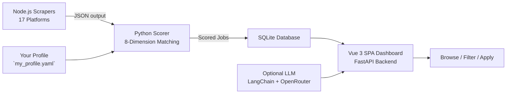

# Job Engine — Smart Job Matching Pipeline 🎯

[](https://python.org)
[](https://nodejs.org)
[](https://vuejs.org)
[](https://fastapi.tiangolo.com)
[](LICENSE)

A local job-hunting pipeline that scrapes 17 platforms, scores every listing against your actual profile, and serves a slick Vue 3 dashboard — all on your own machine.

**Scrape → Score → Browse → Apply — no SaaS subscriptions, no API keys required.**

---

## What is Job Engine?

Job Engine is a two-part pipeline that turns job hunting from a manual search into a data-driven process:

1. **Scrapers** (Node.js + Playwright) collect listings from 17 job boards — BulldogJob, CryptocurrencyJobs, Google Jobs, Indeed, JustJoin.it, LinkedIn, NoFluffJobs, Remote OK, Upwork, and more.
2. **Scorer** (Python) ranks every listing against your profile on 8 weighted dimensions: skill overlap, keyword relevance, career alignment, rate fit, location fit, and more.
3. **Dashboard** (Vue 3 SPA + FastAPI) lets you browse matches, filter by score, manage scrapers, edit your profile, and run optional LLM analysis.

The result: a curated, ranked list of jobs that actually fit *who you are*, not just keyword density.

---

## Architecture



---

## Features

### 🧠 Profile-Driven Scoring
Your `my_profile.yaml` drives everything. The 8-dimension scoring engine ranks every listing against *your* skills, rate, locations, and career goals — not just keyword density. Skills in `critical_categories` get a matching bonus. Re-score after tweaking your profile **without re-scraping**.

### 🕸️ 17 Platforms, One Pipeline
Self-registering scrapers for BulldogJob, CryptocurrencyJobs, CryptoJobsList, Google Jobs, Indeed, Jooble, JustJoin.it, LinkedIn, NoFluffJobs, OLX, Pracuj.pl, Reddit, Remote OK, SimplyHired, Solid.jobs, and Upwork — all feeding into a unified `JobOffer` data model.

### 🧩 Extensible Scraper Catalog
Install and uninstall scraper packages from the dashboard or CLI without touching code. Supports local directories, npm registries, and git repos as catalog sources.

### 🛡️ Stealth & Anti-Detection
Built-in fingerprint randomization, human-mimic delays, and retry logic help scrapers stay under the radar. Proxy support (`HTTP_PROXY`/`HTTPS_PROXY`) for IP rotation.

### 💰 Multi-Currency Salary Matching
Parse salaries in USD, EUR, GBP, PLN, and more — the scorer converts to your preferred currency using cached exchange rates and scores rate fit alongside every other dimension.

### 📊 Vue 3 SPA Dashboard
Browse jobs, filter by score/dimension, view company profiles, track applications, manage scrapers, and analyze skill gaps — all without any external services. The profile editor lets you tweak your profile from the browser and see the scoring impact.

### 📋 Application Tracking & Outcomes
Track every application through its lifecycle: record outcomes (hired, rejected, no response, …) with structured reasons, tick off interview stages (phone screen → technical → onsite → offer), log follow-up contacts, and archive application materials (CV + cover letter + posting) when a run ends. Export your application history to CSV from the Applications page.

### 📅 Follow-up Dashboard Widget
The dashboard surfaces a "Needs Follow-up" card listing active applications with no contact for 10+ days, with a one-click "Log Follow-up" action — so nothing goes cold.

### 🎤 AI Interview Prep Packs
For any application in the pipeline, generate a stage-specific interview prep pack (Phone Screen / Technical / Onsite / Final) that combines the job posting, your CV, and your cover letter into: likely questions with prep tips, STAR answer mappings, a company research brief, and a consistency brief. Saved to `data/archives/applications/{id}/interview_prep_{stage}.md`.

### 📄 CV & Cover Letter PDF Generation
For any tracked application, generate a job-tailored CV (LaTeX, moderncv banking style) and a professional cover letter PDF — both compiled with **tectonic** and verified for ATS compatibility. The **CV Drafter Agent** addresses every job requirement, matches nice-to-haves, and produces a 2-page CV. The cover letter wrapper converts existing plain-text cover letters into a polished letter PDF with sender info, recipient, and professional formatting. CVs are automatically trimmed to fit (relevance-weighted line scoring). Custom `.tex` / `.cls` / `.sty` templates can be uploaded and test-compiled via the API.

### 🧬 Company Entity & Enrichment
Company names are normalized into a dedicated `Company` table with logo, website, description, industry, headcount range, and location — enriched automatically from scrapers that provide it.

### 🧠 Optional LLM Superpowers
Drop in an LLM API key (dashboard Settings tab) and unlock per-job LLM actions: full job analysis, natural-language match explanations ("Why does this job score 78?"), personalized cover letter drafts, and likely interview questions. Powered by LangChain + OpenRouter.

### 📈 Skill Gap Analysis
The upskill page surfaces in-demand skills your profile is missing, weighted by how many high-scoring jobs require them — so you know what to learn next, ranked by impact.

### ⏱️ Dashboard-Controlled Scraping
Enable/disable individual scrapers, configure auto-run schedules, trigger manual runs, and review run history — all from the scrapers page.

### 🐳 Docker
One `docker compose up` to run the whole stack — database and dashboard (which runs scrapers in-process) — without installing anything locally.

---

## Quick Start

**Prerequisites:** Python ≥ 3.11, Node.js 20, and `make`. For CV / cover-letter PDF generation you also need [tectonic](https://tectonic-typesetting.github.io/) and `pdftotext` (poppler) on your `PATH` — e.g. `brew install tectonic poppler` on macOS. The Docker image includes both.

```bash
# 1. Copy the environment template
cp config/.env.example config/.env

# 2. Create your profile (edit this with your details!)
cp examples/my_profile.example.yaml data/my_profile.yaml

# 3. Install everything (Python + Node.js + Vue)
make install

# 4. Open the dashboard
make dashboard    # → http://localhost:8000

# 5. In the dashboard's Scrapers tab, click "Run All" to scrape + seed the database

# 6. See your top matches in the terminal
make score
```

---

## Scraper vs Scorer

The two halves of the pipeline are independent programs that meet at a JSON file:

| | **Scraper** | **Scorer** |
| --- | --- | --- |
| What it does | Collects raw job listings from job boards | Ranks already-collected listings against your profile |
| Language / stack | Node.js + Playwright | Python (`job_engine.skill_scorer`) |
| Input | Search tags from `my_profile.yaml`, scraper settings | `_all.json` (or DB) + `my_profile.yaml` |
| Output | JSON files in `data/scraper-output/` | A 0-100 `match_score` with per-dimension breakdown |
| Network | Yes — hits live job boards, uses stealth delays | No — pure local computation |
| Run it with | Dashboard → Scrapers tab → Run | `make score` |

The scraper answers *"what jobs exist?"*, the scorer answers *"which of them fit me?"*.

---

## Configuration

| File | Purpose |
|------|---------|
| `examples/my_profile.example.yaml` | Template profile — copy to `data/my_profile.yaml` and edit. Tracks in git. |
| `data/my_profile.yaml` | Your skills, boosted keywords, expected rate, preferred locations, remote-only toggle. Gitignored. |
| `data/scraper_config.yaml` | Which scrapers are enabled, pagination limits, max listing age. Editable from the dashboard. |
| Dashboard Settings tab | LLM API key/provider config (`data/app_settings.yaml`). |

---

## Tech Stack

| Layer | Technology |
|-------|-----------|
| **Backend** | Python, FastAPI, SQLAlchemy, SQLite |
| **Scrapers** | Node.js, Playwright (npm workspaces, per-scraper packages) |
| **LLM** | LangChain + OpenRouter (optional) |
| **Frontend** | Vue 3 SPA (Vite, vue-router, Pinia) |

---

## Development

For detailed development documentation — including:

- Full project structure with every file
- Testing discipline (Python pytest + Node.js node:test)
- Scraper output contract with field coverage matrix
- CSS & styling conventions
- Scraper catalog architecture
- Vue 3 SPA development setup

→ **See [DEVELOPMENT.md](DEVELOPMENT.md)**

---

## Security & Local-Only Use

**Job Engine is designed for local use only.** The dashboard has no CORS restrictions, authentication, rate limiting, or encryption. Do not expose it to the public internet. It runs on `localhost:8000` by design.

- No user accounts or login system
- No API authentication or rate limiting
- No HTTPS (plain HTTP only)
- No input sanitization for the local user
- All job posting text is sanitised before reaching any LLM prompt (see [SECURITY.md](SECURITY.md) for the untrusted posting policy)

Running this behind a reverse proxy (nginx, Caddy) is possible but not documented or tested. If you need remote access, use SSH port forwarding (`ssh -L 8000:localhost:8000 your-server`).

---

## Contributing

See [CONTRIBUTING.md](CONTRIBUTING.md).

## License

MIT — see [LICENSE](LICENSE).
