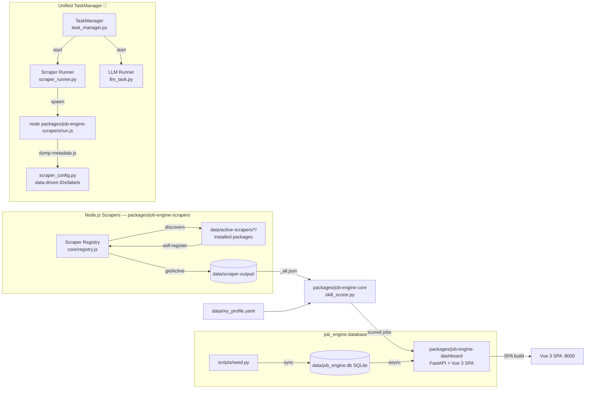

<!--
  architecture.md — Architecture and data flow for the Job Engine.
-->

# Architecture

## Data Flow



## Project Structure

```
job/                                   # Monorepo root
├── packages/                          # Monorepo packages
│   ├── job-engine-core/               # Python core (editable install)
│   │   ├── src/job_engine/
│   │   │   ├── config.py              # .env-driven settings + ProfileConfig
│   │   │   ├── models.py              # SQLAlchemy ORM
│   │   │   ├── database.py            # Async DB helpers, seeding, migration
│   │   │   ├── skill_scorer.py        # JobMatcher — 8-dimension scoring engine
│   │   │   ├── llm.py                 # LangChain + OpenRouter integration
│   │   │   ├── scraper_config.py      # Dashboard scraper toggle/schedule config
│   │   │   ├── scraper_runner.py      # Async ScraperRunManager
│   │   │   ├── task_manager.py        # Unified TaskManager for ALL background work
│   │   │   ├── skill_gap.py           # Skill gap analysis
│   │   │   ├── currency_converter.py  # Multi-currency exchange rates
│   │   │   ├── scraper_catalog_config.py      # Scraper catalog source management
│   │   │   └── _utils.py              # Internal utilities
│   │   └── tests/                     # pytest suite
│   │
│   ├── job-engine-dashboard/          # FastAPI + Vue 3 SPA
│   │   ├── src/
│   │   │   ├── main.js / App.vue / index.html / router/
│   │   │   ├── composables/ stores/ views/ components/
│   │   │   └── dashboard/             # FastAPI backend
│   │   │       ├── main.py, common.py, jobs_helpers.py, scraper_utils.py
│   │   │       └── routes/            # overview, jobs, companies, scrapers, llm, tasks, applications, profile, upskill, app_settings, danger_zone, skills, llm_task, route_helpers
│   │   ├── dist/                      # Built SPA (gitignored)
│   │   └── vite.config.js + package.json + pyproject.toml
│   │
│   └── job-engine-scrapers/           # Node.js scraper framework
│       ├── core/                      # Shared utilities (npm workspace)
│       │   ├── registry.js, scraper-interface.js, run.js, config.js
│       │   ├── browserScraper.js, stealth.js, proxy.js, logger.js
│       │   └── skills.js, salary.js, dedup.js, fetch.js, output.js, tags.js, catalogs.js
│       ├── scrapers/                  # 16 scraper packages
│       │   ├── bulldogjob/, cryptocurrencyjobs/, cryptojobslist/, googlejobs/,
│       │   │   indeed/, jooble/, justjoin_it/, linkedin/, nofluffjobs/,
│       │   │   olx/, pracuj/, reddit/, remoteok/, simplyhired/,
│       │   │   solidjobs/, upwork/
│       │   └── (each: index.js + package.json + README.md)
│       └── tests/                     # node:test suite
│
├── config/                    # Configuration files ONLY (no runtime storage)
│   ├── .env                   # Environment variables (gitignored)
│   ├── .env.example           # Environment template
│   └── .env.ci                # CI environment template
├── examples/                  # Template / example files (tracked in git)
│   └── my_profile.example.yaml # Profile template (copy to data/ and edit)
├── data/                      # ALL runtime storage (gitignored)
│   ├── job_engine.db          # SQLite database
│   ├── my_profile.yaml        # Skills, rate, currency, preferences, behavioral, career goals
│   ├── scraper_config.yaml    # Platform settings (enabled, pagination)
│   ├── scraper_catalogs.yaml  # Scraper catalog registry
│   ├── exchange_rates.json    # Cached currency rates
│   ├── active-scrapers/       # Installed scraper packages
│   └── scraper-output/        # Scraper JSON results + raw data
├── scripts/                   # CLI entry points
│   ├── seed.py                # Load scraped JSON → DB
│   └── cleanup_db.py          # DB cleanup utilities
├── .gitignore
├── Makefile                   # Task runner
├── docker-compose.yml         # Docker compose
├── docker/                    # Dockerfile components
│   └── Dockerfile.dashboard
├── pyproject.toml             # Root project metadata (legacy)
├── requirements.txt           # Root deps (legacy — deps now in package pyproject.toml)
├── AGENTS.md                  # AI agent instruction file (entry point)
├── DEVELOPMENT.md             # Developer reference
└── README.md                  # User-facing documentation
```

For the full annotated tree with every file and sub-directory, see [Project Structure](../DEVELOPMENT.md#project-structure) in DEVELOPMENT.md.

## Matching Engine Dimensions

| Component | Weight | Description |
|-----------|--------|-------------|
| `skill_overlap` | 25% | Profile skills vs job tech stack + critical skill bonus |
| `keyword_boost` | 15% | Boosted domain keywords (trading, fintech, ML) |
| `career_alignment` | 15% | Fit with long-term trajectory and domain interests |
| `behavioral_fit` | 13% | Culture, collaboration, and growth signals |
| `rate_fit` | 12% | Salary range vs expected rate (configurable currency) |
| `location_fit` | 8% | Remote / hybrid / city match |
| `category_fit` | 8% | Category (python, backend, data, ai) |
| `experience_fit` | 4% | Seniority level match |

## Company Entity

The system normalizes company names into a dedicated `Company` table with a FK from `Job`:

| Field | Type | Description |
|-------|------|-------------|
| `id` | PK | Auto-increment |
| `name` | String(255), unique | Normalized company name |
| `url` | Text (nullable) | Company website |
| `logo_url` | Text (nullable) | Company logo image |
| `description` | Text (nullable) | About the company |
| `industry` | String(100) (nullable) | Industry sector |
| `size_range` | String(50) (nullable) | Employee count e.g. "50-200" |
| `headquarters` | String(255) (nullable) | HQ location |
| `founded_year` | Integer (nullable) | Year founded |
| `linkedin_url` | Text (nullable) | LinkedIn company page |

Companies are auto-created on job import via `_get_or_create_company()` in `save_jobs_sync()`.
For existing databases, run `make migrate` to create the companies table and back-fill `company_id`.