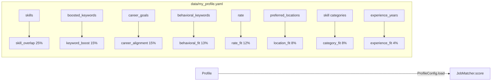

# Profile Setup Workflow

> **Purpose:** Create and maintain your personal profile — the central configuration that drives the entire matching engine. Skills, rate preferences, career goals, and behavioral keywords all feed into the 8-dimension scoring algorithm.

## Layer Overview

```mermaid
flowchart LR
    EXAMPLE[data/my_profile.example.yaml] --> PROFILE[data/my_profile.yaml]
    PROFILE --> SCORER[skill_scorer.py]
    PROFILE --> LLM[llm.py]
    PROFILE --> API[/api/profile]
    API --> DASH[/settings page]
    DASH --> EDIT[Profile Editor in Dashboard]
    EDIT --> API
    API --> PROFILE
```

## Step-by-Step

### 1. Initial Profile Creation

Copy the example profile to your working profile:

```bash
cp data/my_profile.example.yaml data/my_profile.yaml
```

Then edit `data/my_profile.yaml` with your details. The file is YAML with these top-level sections:

### 2. Profile Sections

| Section | Key | Description |
|---------|-----|-------------|
| **Identity** | `name`, `role`, `experience_years` | Who you are and your headline role |
| **Rate** | `rate.min_monthly`, `rate.max_monthly`, `rate.currency` | Expected salary range (PLN, USD, EUR, etc.) |
| **Skills** | `skills` | Category-keyed map of skills (backend, databases, ml_data, etc.) |
| **Critical Categories** | `critical_categories` | Skill categories that get a +5 bonus per match (capped at +20) |
| **Boosted Keywords** | `boosted_keywords` | Domain keywords for the `keyword_boost` dimension (15% weight) |
| **Experience** | `experience` | List of past projects (name + description) |
| **Behavioral** | `behavioral_keywords` | Culture keywords for `behavioral_fit` dimension (13% weight) |
| **Career Goals** | `career_goals` | Long-term trajectory for `career_alignment` (15% weight) |
| **Location** | `remote_only`, `preferred_locations` | Remote preference and location list |
| **Exclusions** | `excluded_companies` | Case-insensitive list of companies to hide |
| **External Files** | `cv_file`, `style_file`, `rules_file` | Optional paths to external content files |

### 3. Skills Section (Detailed)

Skills are organized by category — each category is a list of individual skills:

```yaml
skills:
  backend:
    - python
    - fastapi
    - pydantic
    - asyncio
    - pytest
  databases:
    - postgresql
    - sqlalchemy
    - redis
    - mongodb
  ml_data:
    - pandas
    - numpy
    - scikit-learn
    - langchain
  domain:
    - fintech
    - trading
    - algorithmic_trading
    - quantitative_analysis

# Categories that get a critical match bonus (+5 per match, max +20)
critical_categories:
  - backend
  - databases
  - domain
```

### 4. Rate & Currency

```yaml
rate:
  min_monthly: 25000   # PLN — minimum acceptable monthly rate
  max_monthly: 45000   # PLN — maximum / target monthly rate
  currency: PLN        # Currency code (PLN, USD, EUR, GBP, etc.)
```

The `rate_fit` scoring dimension (12% weight) compares job salary ranges against this band. Multi-currency conversion is handled by `currency_converter.py` using cached exchange rates from `data/exchange_rates.json`.

### 5. Location Preferences

```yaml
remote_only: true
preferred_locations:
  - remote
```

- `remote_only: true` → only jobs with `remote: true` get a location score
- `preferred_locations` → list of cities/locations where you're willing to work
- Jobs matching `preferred_locations` get a higher `location_fit` score (8% weight)

### 6. Dashboard: Profile Editor

Navigate to **`http://localhost:8000/settings`** (or the Settings page):

| Section | Editor | Endpoint |
|---------|--------|----------|
| **Identity** | Text fields | `PATCH /api/profile` |
| **Rate** | Number inputs + currency select | `PATCH /api/profile` |
| **Skills** | Tag-style input per category | `PATCH /api/profile` |
| **Keywords** | Tag input for boosted_keywords | `PATCH /api/profile` |
| **Behavioral** | Tag input for behavioral_keywords | `PATCH /api/profile` |
| **Career Goals** | Tag input for career_goals | `PATCH /api/profile` |
| **Excluded Companies** | Tag input | `PATCH /api/profile` |
| **CV Upload** | File upload → text extraction | `POST /api/profile/upload-cv` |

**Editing flow:**

1. Edit any section in the dashboard
2. Click "Save" → sends `PATCH /api/profile` with `{"section": "skills", "values": [...]}`
3. Backend calls `ProfileConfig.update_section()` which:
   - Loads the full YAML file
   - Updates the specified top-level key
   - Writes back preserving comments and formatting (ruamel.yaml round-trip)

### 7. Advanced: CV Upload & Parsing

```bash
# Upload a CV file (PDF/DOCX/TXT)
POST /api/profile/upload-cv
# → Extracts text, saves to data/my_cv.md

# Parse CV text with LLM (extract skills, experience)
POST /api/profile/parse-cv-text
# → Returns structured profile data

# Improve CV with LLM suggestions
POST /api/profile/improve-cv
# → Returns improvement suggestions
```

### API Endpoints

| Method | Endpoint | Purpose |
|--------|----------|---------|
| `GET` | `/api/profile/data` | Get full profile data |
| `PATCH` | `/api/profile` | Update a profile section |
| `POST` | `/api/profile/append-items` | Append items to a list section |
| `POST` | `/api/profile/upload-cv` | Upload CV file |
| `POST` | `/api/profile/parse-cv-text` | Parse CV with LLM |
| `POST` | `/api/profile/improve-cv` | Get CV improvement suggestions |
| `GET` | `/api/currencies` | List supported currencies |
| `GET` | `/api/exchange-rates` | Get cached exchange rates |
| `POST` | `/api/profile/refresh-rates` | Refresh exchange rates |

### CLI Commands

```bash
# Refresh exchange rates
make refresh-rates

# Check rate status
make rates-status
```

### Data Model: `ProfileConfig`

**`ProfileConfig`** class in `packages/job-engine-core/src/job_engine/config.py`:

| Method | Description |
|--------|-------------|
| `load()` | Return full profile as dict |
| `save(data)` | Write full profile dict to YAML |
| `update_section(section, values)` | Update one top-level key, write, return full profile |

Uses `ruamel.yaml` round-trip loader to preserve comments, formatting, and key order on save.

### How the Profile Feeds the Engine



### Layer Trace

| Layer | File | Key Code |
|-------|------|----------|
| **Config** | `packages/job-engine-core/src/job_engine/config.py` | `ProfileConfig` class, `JobEngineConfig` |
| **Core** | `packages/job-engine-core/src/job_engine/skill_scorer.py` | `load_profile()`, `normalize_skills()` |
| **Core** | `packages/job-engine-core/src/job_engine/currency_converter.py` | `convert()`, `refresh_rates()` |
| **API** | `packages/job-engine-dashboard/src/dashboard/routes/profile.py` | `get_profile_data()`, `update_profile_section()`, `append_profile_items()` |
| **Composable** | `packages/job-engine-dashboard/src/composables/useAddToProfile.js` | Add skill/keyword/goal to profile |
| **Component** | `packages/job-engine-dashboard/src/views/...` | Settings page with profile editor |

### Troubleshooting

| Symptom | Likely Cause |
|---------|-------------|
| Scorer returns 0s | `data/my_profile.yaml` missing or empty. Run `cp data/my_profile.example.yaml data/my_profile.yaml` |
| Currency mismatch | Exchange rates stale. Run `make refresh-rates` |
| Skills not matching | Skill names are normalized (lowercased, stripped). Check exact spelling against job descriptions |
| Profile save fails | YAML syntax error in the file. Validate with `python -c "import yaml; yaml.safe_load(open('data/my_profile.yaml'))"` |
| Profile section not updating | `section` key must match a top-level key in the YAML file exactly |