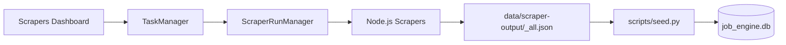

# Scrape & Seed Workflow

> **Purpose:** Run scrapers to collect job listings from enabled platforms, output them as JSON files, then seed the database with the results.

Scraping is triggered exclusively from the dashboard (or its API) — there is no standalone CLI entry point. The dashboard spawns the same Node.js orchestrator as a subprocess, in-process.

## Layer Overview



## Step-by-Step

### 1. Trigger a Run from the Dashboard

Navigate to `http://localhost:8000/scrapers` and click "Run All" (or "Run" on a single scraper card). This sends `POST /api/scrape` (or `/api/scrape/scraper/{id}`), which:
1. Spawns `node packages/job-engine-scrapers/run.js` as a subprocess — the Node.js scraper orchestrator
2. Once it finishes, runs `scripts/seed.py` to seed the DB from the output JSON

To re-seed from an existing JSON output without re-scraping:

```bash
make seed
```

### 2. Scraper Runner Architecture

| Component | File | Role |
|-----------|------|------|
| `ScraperRunManager` | `packages/job-engine-core/src/job_engine/scraper_runner.py` | Orchestrates scraper runs as subprocesses, tracks state per run |
| `TaskManager` | `packages/job-engine-core/src/job_engine/task_manager.py` | Unified background task tracker (scrapers + LLM) |
| `run.js` | `packages/job-engine-scrapers/core/run.js` | Node.js orchestrator — spawns individual scrapers, collects output |
| `ScraperRegistry` | `packages/job-engine-scrapers/core/registry.js` | Self-registering scraper discovery |

**Flow:**
1. `TaskManager.start()` creates a `Task` with type `scraper_run`
2. `ScraperRunManager` spawns `node packages/job-engine-scrapers/run.js` as a subprocess
3. `run.js` discovers enabled scrapers via `ScraperRegistry` and runs each one
4. Each scraper writes its results to `data/scraper-output/<id>.json`
5. After all scrapers finish, `run.js` merges all results into `data/scraper-output/_all.json`
6. Structured events prefixed with `##SCRAPER_EVENT##` are emitted to stdout for real-time progress tracking

### 3. Output Location

| File | Description |
|------|-------------|
| `data/scraper-output/_all.json` | Merged output of all scrapers (consumed by seed) |
| `data/scraper-output/<scraper_id>.json` | Per-scraper output files |
| `data/scraper-output/raw/` | Raw HTML/browser responses (debugging) |

### 4. Database Seeding

```bash
make seed
```

The `scripts/seed.py` script:
1. Reads `data/scraper-output/_all.json`
2. Initializes the SQLite database via `init_db_sync()`
3. Calls `save_jobs_sync()` which:
   - Normalizes company names via `_get_or_create_company()`
   - Upserts each job by `external_id` (skips duplicates)
   - Prints count of new vs total jobs

### 5. Dashboard: Trigger & Status

Navigate to **`http://localhost:8000/scrapers`** to:

- **Manual trigger:** Click the "Run All" button → sends `POST /api/scrape` → triggers `TaskManager`
- **Single scraper:** Click "Run" on any scraper card → sends `POST /api/scrape/scraper/{id}`
- **Live status:** The page polls `GET /api/scrape/status` every 2 seconds via `useTaskPoll` composable
- **Run history:** Scroll to the history section → `GET /api/scrape/history`

### API Endpoints

| Method | Endpoint | Purpose |
|--------|----------|---------|
| `POST` | `/api/scrape` | Start all scrapers |
| `POST` | `/api/scrape/scraper/{id}` | Start a single scraper |
| `GET` | `/api/scrape/status` | Current run status |
| `GET` | `/api/scrape/status/{task_id}` | Status by task ID |
| `GET` | `/api/scrape/history` | Run history |
| `GET` | `/api/scrape/logs/{task_id}` | Log lines for a run |
| `POST` | `/api/scrape/cancel/{task_id}` | Cancel a running run |

### Layer Trace

| Layer | File | Key Code |
|-------|------|----------|
| **DB** | `packages/job-engine-core/src/job_engine/database.py` | `save_jobs_sync()`, `init_db_sync()` |
| **API** | `packages/job-engine-dashboard/src/dashboard/routes/scrapers.py` | `api_scrape_start()`, `api_scrape_status()` |
| **Composable** | `packages/job-engine-dashboard/src/composables/useTaskPoll.js` | Polls task status, emits progress |
| **Component** | `packages/job-engine-dashboard/src/views/ScrapersView.vue` | Run button, progress bar, history table |

### Troubleshooting

| Symptom | Likely Cause |
|---------|-------------|
| `_all.json` not found | Trigger a run from the dashboard's Scrapers tab first |
| No scrapers run | Check `data/scraper_config.yaml` — scrapers must be `enabled: true` |
| DB seed reports 0 new | Jobs already in DB (run is idempotent) |
| Dashboard shows "no active scraper config" | `data/scraper_config.yaml` missing — trigger one run from the dashboard to generate it |